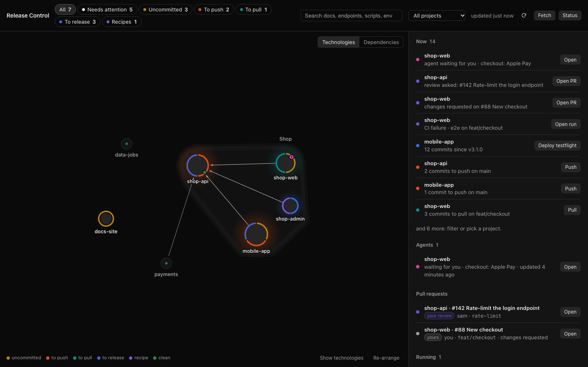
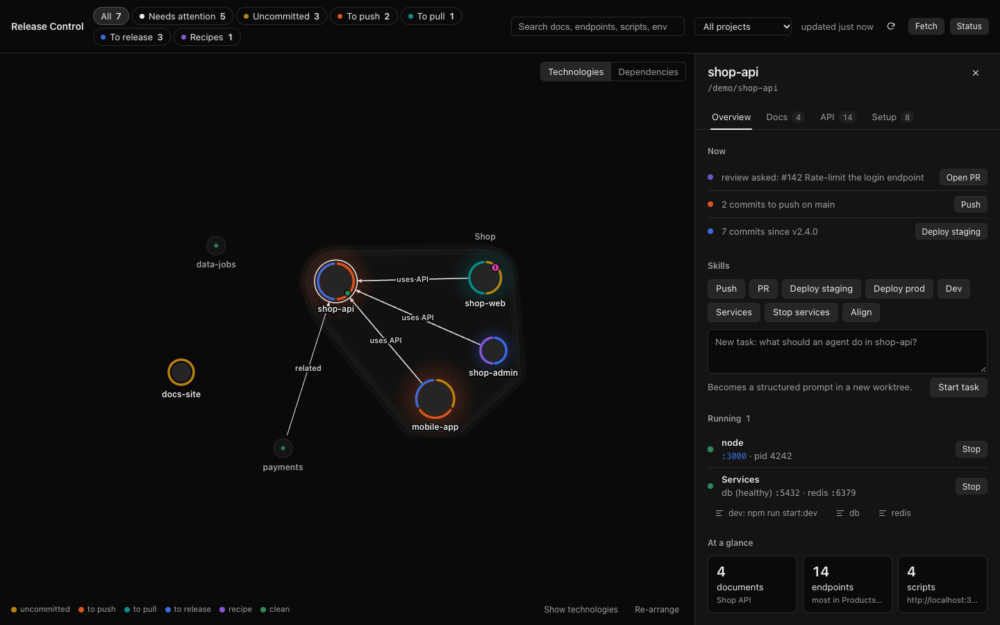
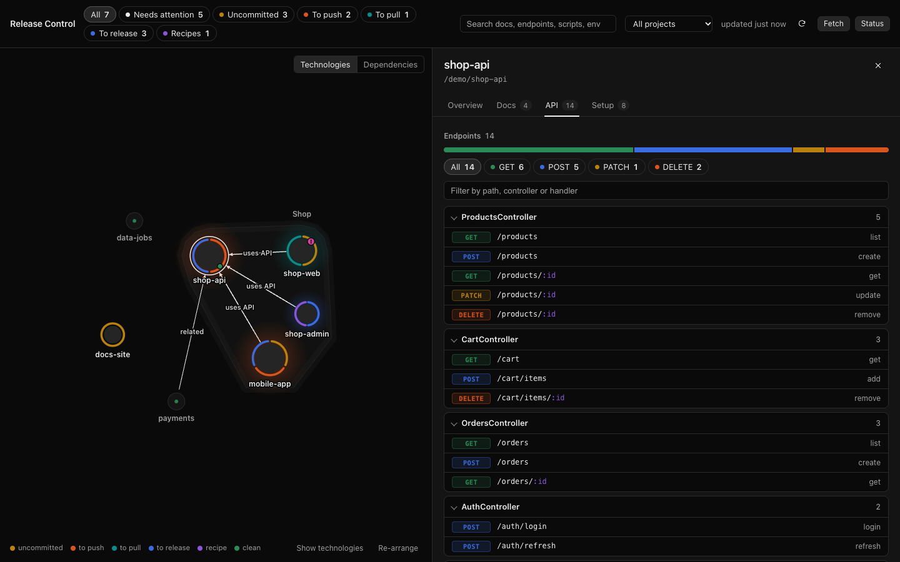
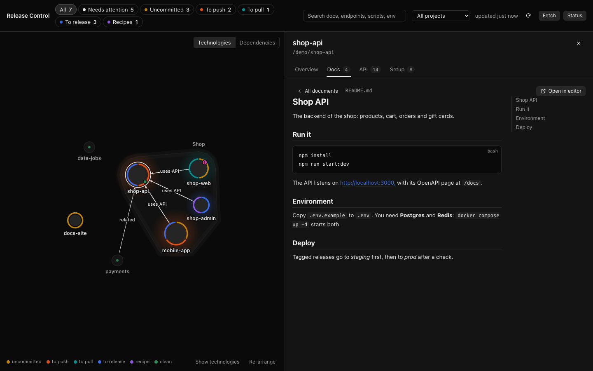
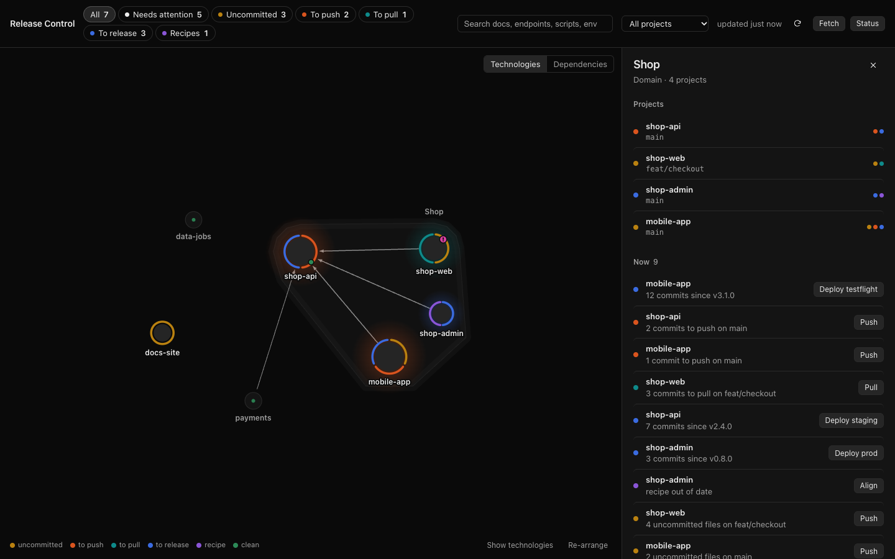

# orca-release

**Release skills and a release board for [Orca](https://onorca.dev).** Each project gets one *recipe* with its
pre-push checks, deploy targets, local services and dev processes; the agents Orca launches (Claude, Codex, Gemini,
Grok…) follow it step by step, never skip one silently, and ask before anything that pushes or releases.
**Release Control**, an Orca plugin, shows every project on one board and does the mechanical parts itself, without an
agent: fetch, pull, start services and dev, run scripts, read docs and APIs, clean up merged branches.



<table>
<tr>
<td></td>
<td></td>
</tr>
<tr>
<td align="center">A project: what is waiting, its skills, what runs</td>
<td align="center">API: endpoints read from the code</td>
</tr>
<tr>
<td></td>
<td></td>
</tr>
<tr>
<td align="center">Docs, read right in the board</td>
<td align="center">A domain: projects that belong together</td>
</tr>
</table>

<sub>Screenshots use a fictional workspace (<code>tools/screenshots/</code>).</sub>

| Skill | Say | What it does |
|---|---|---|
| `/push` | "push this branch" | branch check → the project's pre-push checks → confirmed `git push` |
| `/pr` | "open a PR" | push if needed → drafts title/body from commits → `gh pr create` (GitHub) or browser + clipboard (Gitea, other hosts) |
| `/deploy` | "deploy to staging", "release" | pick target → run its steps → confirm before anything that releases |
| `/compose` | "start the services", "stop the db", "reset the db" | local support services (db, mocks) from the recipe's `## compose`: up (waits until healthy), stop, status, logs, reset (asks first) |
| `/dev` | "start dev" | compose services, then each `## dev` process in its own Orca terminal |
| `/align` | "align the recipes", "what do I need to update" | scans recipes vs repos (✗ broken, + new, ? to confirm), proposes and saves fixes |
| `/status` | "project status" | every Orca repo: branch, unsaved changes, unpushed / to-pull commits, local-only branches, worktrees, recipe drift, open PRs |
| `/updates` | "any updates?", "what's new in …" | read-only outdated deps per project + news/breaking/security for the stacks in `tech-watch.md` |
| `/weekly-report` | (Monday automation) | both of the above → `reports/YYYY-MM-DD.md` |
| `/prompt` | "new task: …" | rough request → structured prompt from the project's real context → agreed with you → new Orca worktree + agent |
| `/dashboard` | "dashboard" | local HTML page in your data folder (never uploaded): releases, unsaved/unpushed work, drift, Monday report |
| `/release-setup` | "set up the release skills" | first-time setup: interview, data folder, recipes, optional session hint / Quick Commands / Monday report |
| `orca-release` | — | engine: `procedure.md`, `templates/`, `scripts/` used by all the others |

Every skill also understands Italian requests ("fai il push", "allinea le ricette", "stato dei progetti"…) and answers
in the user's language.

**Release Control** (Orca plugin, `plugin/release-control/`): projects as a constellation lit by their release state;
a page per project with its docs, API endpoints, scripts and env names; agents waiting for you, PRs and CI, what is
running, your day for the standup, cleanup, search across projects; Push/PR/Deploy launch the real skill. Details:
[`plugin/release-control/README.md`](plugin/release-control/README.md).

## Requirements

- [Orca](https://onorca.dev) ≥ 1.4.248 (plugins: Settings → Plugins), `git`, `python3` (3.9+), `bash`.
- Optional: `gh` (GitHub PRs and CI), `docker` (local services).
- Tested on macOS. Linux should work but is not tested yet; Windows and SSH workspaces are not supported.

## Install

```bash
git clone https://github.com/<you>/orca-release ~/src/orca-release   # anywhere except your data folder
cd ~/src/orca-release
./install.sh                     # links the skills into ~/.claude/skills, ~/.agents/skills (and Gemini/Grok when present)
```

Then, in any agent Orca launches, say **"set up the release skills"** (`/release-setup`): it creates your own data
folder (default `~/orca-release-data`, a git repo for your recipes and reports — never this clone), writes one recipe per
project with you, and offers the session hint, Quick Commands and the Monday report. Already have a data folder?
`./install.sh --data <dir>`. Re-running `install.sh` is safe; `git pull` updates the skills in place.

Release Control:

```bash
orca plugin dev load plugin/release-control --json    # prints the permissions and an --approve command; run it after reading them
```

When a Claude session starts in a repo that has a recipe or a compose file, a one-line hint shows the project's stack
and the skills that apply (e.g. `📦 shop-api · node docker · skill: /compose /push /pr /deploy`), plus
`⚠ recipe out of date: /align` when the scanner finds drift.

Engine scripts live in `skills/orca-release/scripts/` (below: `S=skills/orca-release/scripts`).
Scan from the terminal: `$S/scan-recipes.sh` (all) or `$S/scan-recipes.sh --repo .`.
Rebuild everything from scratch: give `REPRODUCE.md` to an agent.

Each project's commands and checklist live in **one recipe** in your data folder's `recipes/`. The skills find the
recipe for the repo you're in (by git remote, or by path), show the checklist first, run steps in order, and never
skip one silently.

## Recipes

Start from `skills/orca-release/templates/recipe.md` (example: `skills/orca-release/examples/`). Step syntax is strict:

- `` - [ ] `command` `` → the agent runs exactly that command
- `- [ ] anything else` → manual: the agent shows it and waits for your OK

Steps that were guessed end with `<!-- inferred: confirm -->`. Remove the marker once verified.
Deploy targets are `### name` headings under `## deploy`; `(confirm)` asks before starting.

Add a project: run `/push` (or `/pr`, `/deploy`) in it. With no recipe, the skill drafts one
from the repo, shows it, and after your OK saves and commits it here.

### Environments (optional)

Under a deploy target, `- url: https://…` and `- health: /health` are its address and health check (not steps).
Release Control then shows each environment as up/down with its latency, the deployed version (from the JSON's
`version` / `commit` / `sha` … or an `X-Version` / `X-Commit` header) and how many commits it is behind the default
branch; a target that is down goes into "Now". `$S/work.py health .` prints the same from a terminal.

### `## links` (optional)

```markdown
## links
- domain: shop                 # projects with the same domain are grouped on the Release Control board
- domain-label: Shop
- uses-api: shop-api           # uses-api | follows | replaces | related → another recipe id, or ext:<Name>
- replaces: ext:Legacy CMS
```

The scanner proposes links it finds in each repo's docs (`+ link? …`); `/align` turns them into typed lines after your OK.
Shared dependencies are read from the lockfiles, no recipe needed.

### `## compose` (optional)

```markdown
## compose
- file: `docker-compose.yml`       # never a *.dev.yml server file
- project: my-project              # compose project name; keep the one the stack already uses
- services: postgres mock          # absent = every service without a profile
- oneshot: create-bucket           # services that run once and exit (started before --wait)
- note: Postgres on 5433
- up: `make dev-up`                # optional overrides: up / stop / reset
```

All worktrees of a project share one stack (`-p <project>`). `stop` keeps data; `reset` deletes it after confirmation.
See the exact commands with `$S/compose-cmd.sh recipes/<id>.md <up|stop|status|logs|reset|volumes>`.

### Session hint

`install.sh` (or `$S/register-hint.sh`) adds an extra `SessionStart` hook (Claude Code only) (marked `orca-release-hint`) to `~/.claude/settings.json`
and to each Orca profile's `settings.json`, after backing each file up to `settings.json.orca-release.bak`.
Orca's own hook is untouched. To disable it, delete the entry whose command contains `orca-release-hint`.

### Orca Quick Commands

One-click entries in Orca's Quick Commands menu (tab bar button, or right-click in a terminal):
global **Guided push / Open PR / Deploy / Local services / Align recipes / Updates / Project status / New task / Start dev** (open the agent with the skill)
and, for each project with `## compose`, **▶ Start services / ■ Stop services / Services status** (plain terminal commands; no reset).

```bash
python3 -I $S/quick_commands.py build > ~/orca-quick-commands.json      # reads `orca repo list` (Orca open)
python3 -I $S/quick_commands.py guide ~/orca-quick-commands.json         # step-by-step list to add them
```

Add each entry in Orca → Settings → Quick Commands → **Add Command** as the guide says.
There is no automatic write on purpose: Orca keeps settings in a per-profile SQLite store
(`profiles/<id>/profile-state.db`, with revisions and content hashes) and has no CLI for quick commands;
the old `orca-data.json` is no longer read.

## Sharing without git (Orca skills)

You can also hand the skills to someone as an Orca skills bundle. Only `skills/` is shared — never your data folder.
Enable Orca → Settings → **Share Skills** once, then:

```bash
orca skills share --skill orca-release --skill release-setup --skill push --skill pr --skill deploy \
  --skill compose --skill dev --skill align --skill updates --skill weekly-report --skill status \
  --skill prompt --skill dashboard \
  --bundle-name "Orca release skills" --release-notes "$(sed -n '/^## /,$p' CHANGELOG.md | head -20)"
```

Send the link plus `ONBOARDING.md`. They install the bundle in Orca and say "set up the release skills".

Check recipes: `$S/validate-recipes.sh .`
Which recipe applies here: `$S/find-recipe.sh [dir]`

## Tests

```bash
bash tests/run.sh                                   # engine and skills (CI runs these)
cd plugin/release-control && orca plugin test . --json   # the plugin (needs the orca CLI)
```

## Docs

- Release Control: [`plugin/release-control/README.md`](plugin/release-control/README.md), product and visual system in
  `PRODUCT.md` and `DESIGN.md`
- Illustrated guide: `docs/guide.html` · guided setup for a person: `ONBOARDING.md` · rebuild from scratch: `REPRODUCE.md`

## Publishing (maintainers)

`tools/export-public.sh <dir>` copies exactly the files listed in `tools/public-files.txt` and refuses if any of them
mentions the maintainer's recipe names, hosts, user, home or git identity (plus `.private-words`, untracked).

## License

MIT, see `LICENSE`.
